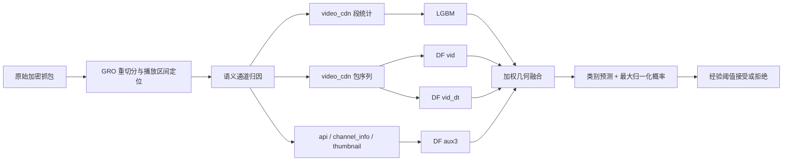

**项目理解与开集性能优化可行性方案｜2026-11-09**

本报告核对当前代码、最优配置、原始实验 JSON、数据 provenance，并补做验证集诊断。当前代码基线为 `4566cbc`。结论是：保留现行通道拆分 geo4；先解决缺失辅助信息与低误报阈值迁移，再试验路径／下载批次表示。现有证据不支持继续把主要预算投入更换骨干、增加训练轮数或扩大融合网格。

本轮新增 [审计脚本](E:/evb/df/scripts/audit_openset_feasibility.py) 和 [诊断结果](E:/evb/df/runs/open_set_feasibility_20261109/report.json)。没有训练新模型、改变划分、覆盖模型缓存或用测试概率搜索新配置。下文测试成绩来自已有报告；新增分数与样本诊断仅使用验证数据。脚本中的基线回归断言已通过，验证三档成绩与历史报告一致。

**核心目标与现有技术路线**

目标是从已经定位的加密 YouTube 播放流量中识别具体 VID，并拒绝不属于已知库的其他视频。首要指标是正确识别且接受的比例 TPR@0.5%FPR，兼顾 1%／5% 档、闭集 Top-1、实际部署误报率及观察成本。这里 TPR 要求预测类别正确；单纯把已知视频判为“已知”还不够。

当前严格划分包含 644 个视频：386 个已知类别，129 个验证未知视频，129 个测试未知视频。已知类别按会话划分。当前数据共 20,863 个会话，训练会话 7,549；实际评分的已知 probe 为验证 1,449、测试 1,223，未知会话为验证 4,175、测试 4,153。另有独立标记为 gallery 的已知会话，不能与 probe 数混用。

LGBM 读取 video_cdn 下行事件，以 45ms 间隔切分传输片段，取前 16 段的字节量、比例、间隔、时长等组成 120 维特征。这些切分片段不应直接等同于真实媒体段。DF 按通道内包序号读取带方向的 log 大小，dt 变体额外读取通道内时间间隔。每分支为四块卷积池化，宽度 32/64/128/256，再接两层 512 维全连接分类头。

“10s”是数据集标签，主要对应两个下载 batch；当前实际区间中位数 4.532s、p90 13.677s，且有 641 个会话仅含一个 batch。模型能力以播放区间已被定位为前提；任意连续混合流量中的定位仍是另一项任务。

**当前最优配置，应以此作为后续所有实验的参照**

| 成员 | 输入 | 关键配置 | geo 权重 |
|---|---|---|---:|
| LGBM v2 | video_cdn 段统计 | 120 维，63 leaves，最多 1500 rounds | 0.15 |
| DF vid | video_cdn | logsize，长度 8192，最佳 epoch 66 | 0.15 |
| DF vid_dt | video_cdn | logsize + dt，长度 8192，最佳 epoch 78 | 0.30 |
| DF aux3 | api / channel_info / thumbnail | 长度 768 / 192 / 384，最佳 epoch 90 | 0.40 |

三个 DF 都是 branch 网络、seed42、最多 100 epochs、batch64、AdamW lr=1e-3、wd=1e-4、OneCycle、CE label smoothing=.05、min_epochs15、patience12；checkpoint 仍按验证 Top-1 选择。最佳 epoch 是报告中的从零开始编号。

融合为 \(q_c\propto\prod_m p_{m,c}^{w_m}\)，温度为 1，最后在类别维重新归一化。类别取 argmax，接受分数取 max(q)。这是固定权重专家集成，没有学习型路由器。

| 严格协议历史 test | Top-1 | TPR@0.5% | TPR@1% | TPR@5% |
|---|---:|---:|---:|---:|
| 当前通道拆分 geo4 | **94.28%** | **82.26%** | **84.96%** | **90.02%** |
| nogro 全通道组合基线 | 94.36% | 79.72% | 83.65% | 89.29% |
| 旧 GRO 线 geo4 | 97.54% | 65.39% | 72.94% | 88.04% |

前两行来自 [组合报告](E:/evb/df/runs/combo_10s_nogro_L8k_chsplit4/report.json) 和 [配对验收报告](E:/evb/df/runs/ng_boot_chsplit4_vs_base/report.json)。当前配置按验证未知池设 0.5% 阈值后，在历史 test 上 TPR=82.34%，实际 FPR=0.5297%；这与在测试未知分布上读取的 oracle ROC 点 82.26% 是两种口径，必须分别报告。

通道拆分相对全通道基线的 0.5% 档提升为 **+2.53pp**，配对视频簇 bootstrap 95% 区间为 **[-2.01,+9.93]pp**。项目已采纳它为推荐配置；这是工程采纳事实，仍需如实保留统计不确定性。不能把 bootstrap 中正差值的比例理解成“真实有效的后验概率”。

README 中的 86.1% 是旧未知身份交叠协议，不能作为严格协议当前成绩。fast50 的约 11.5ms 速度预算及性能对照来自旧的 nogro 全通道组合；尚不能直接写成当前 vid/vid_dt/aux3 四成员系统的延迟或性能。其“CI 含零”也不构成 1.5pp 界值下的正式非劣证明。

**数据核查需要修正一项关键因果解释**

[当前变更文档](E:/evb/df/BEST_MODEL_20261109.md) 把 nogro 描述为关闭 GRO 后重新采集，并将旧线到 nogro 线的 +14pp 全部归因于观测粒度。磁盘证据支持更谨慎的解释：

- [预处理版本](E:/evb/datasets/600classes_30samples_10s_no_gro/dataset/provenance/preprocessing_version.json) v6.1.0 说明先对 UDP GRO 合并数据报进行重切分；[解析配置](E:/evb/datasets/600classes_30samples_10s_no_gro/dataset/provenance/parser_config_20261105_152445.json) 是 `gro_split=true, gro_seg=0`，即自动推断切分长度。
- 旧库 19,399 个 session_id 全部仍在新库，原 pcap SHA256 全部相同。新库增加 1,464 个会话；19,987 个会话应用了 1250B 重切分，876 个未应用。
- 视频身份划分保持相同，但共有会话中 **6,545 个已知会话的 train/val/test 角色发生变化**。同一个 seed 不保证增加会话后会话划分不变。
- 当前 nogro 划分内部未发现同一 pcap 哈希跨 role/split；这是旧新版本比较的混杂因素，不是已经发现当前协议内部有抓包泄漏。

因此，现有成绩支持“整套 nogro 数据／表示／划分配置更强”，不足以单独识别重切分的净收益。匹配原始 capture、统一会话划分后重训，才能完成归因。重切分也不能凭空恢复合并前逐包到达时间；抽查中连续拆出事件具有相同时间戳，dt 的零值结构需纳入诊断。

模型代码目前读取加密事件、path_ids 与语义标签，没有读取解密 HTTP 内容作为特征。数据另有并行解密产物；它可以协助检查分段标签，却不应在“未解密流量识别”的模型输入中混用。上游完整归因实现不在本仓库，本轮没有声称完成全部上游审计。

**本轮新增诊断：改进空间具体在哪里**

历史测试的 Top-1 与严格接受率差为 **12.02pp**，约占总失败的 68%；余下 5.72pp 是类别判断错误。固定类别预测时，仅改变拒识分数的上限是 94.28%，但这是数学上限，不是可实现收益预测。验证集也呈现同样结构：1,218 个认对且接受、159 个认对但拒绝、72 个分错。

| 验证子群 | 数量 | channel_info 缺失 | video 超 8192 | video path 数中位数 |
|---|---:|---:|---:|---:|
| 认对且接受 | 1,218 | 3.86% | 0.33% | 5 |
| 认对但拒绝 | 159 | **27.67%** | 3.14% | 5 |
| 分错 | 72 | 48.61% | 12.50% | 5 |
| 最危险未知尾部 | 20 | 5.00% | **0%** | 5 |

159 个正确拒绝样本中，44 个缺失 channel_info；即便理想地全部救回且不产生额外误报，也只有验证集约 **3.04pp** 的空间。这足以支持一个小实验，但不能推断“缺失就是拒绝的原因”。可能存在日期、缓存状态或 VID 难度等混杂因素，应按 VID／日期匹配检查。

最危险的 20 个未知样本只来自 **4 个 VID，分别贡献 11/7/1/1 条**。当前 4,175 条未知验证会话只允许接受 20 条；阈值尾部由极少数身份主导，重复这些视频的更多会话不能替代更多未知身份。

对这些未知样本，aux3 给融合预测类别的概率中位数为 0.576；对正确拒绝样本则仅 0.0595。辅助专家依然会在少数未知身份上同向误信，也会误伤真实身份。因此，整体 argmax 一致率约 0.3% 并不等于统计独立，更不意味着危险尾部已经独立。新成员应评价尾部同类高置信与对真实样本的误伤，不能只看平均一致率或单模型 Top-1。

**阈值评估存在可改进空间**

[组合器](E:/evb/df/scripts/run_combiner.py:608) 对 plain geo 直接把完整验证分数送入 pooled_metrics，分数本身不依赖校准折，所以 plain 家族的池化 LOVO 与完整验证排序等价。此设置适用于比较固定分数，却没有外层留出评估整个权重选择过程；它不等于已经证实阈值跨未知身份迁移。

本轮固定现有模型与权重，将已知／未知验证 VID 分成五折，在另外四折的未知池标定 0.5% 阈值，然后评估留出折。五种固定分折种子的实际 FPR 为 **0.671%–1.413%，均值 0.977%**。这不是新的 test 成绩，也不是独立泛化估计：权重和模型此前已使用完整验证集。它只说明“某次历史 test 的 0.53% 很接近名义值”不能保证下一批未知身份仍如此。

建议下一轮区分开发选择、阈值标定和最终测试三个身份池；已有历史 test 继续作为回归基准。真正的折外评估必须在外层训练部分完成权重／规则选择，冻结后才进入外层未知视频。正式置信区间分别以已知 VID 与未知 VID 为簇，保持配对；样本级 bootstrap 会低估身份聚集带来的不确定性。

**低成本打分方向已有新的负证据**

旧路线报告提出保留几何融合的归一化因子：

\[
Z(x)=\sum_c\prod_m p_{m,c}(x)^{w_m},\qquad
s_\beta=\log\max_c q_c+\beta\log Z.
\]

本轮只用当前验证缓存，固定权重，预先限定 β 为 0/.1/.25/.5/1：

| β | 验证 TPR@0.5%FPR |
|---:|---:|
| 0，当前基线 | **84.06%** |
| 0.1 | 83.44% |
| 0.25 | 82.95% |
| 0.5 | 81.44% |
| 1 | 81.23% |

正确拒绝样本的 Z 中位数 0.172，比危险未知尾部的 0.212 更低；直接惩罚低一致性会继续误伤一部分真实样本。分组选择 β 也未给出稳定优势，故此方向降级，不继续扩大超参数搜索，也不把旧 GRO 线上局部正结果当作当前主线收益。

**建议实施的有限候选清单**

| 顺序 | 假设与最小实验 | 为什么值得做 | 成本与主要失败条件 |
|---|---|---|---|
| P0 | 固化当前模型／样本身份；建立外层 VID 评估、独立阈值池；补 model seeds 43/44/45 | 尾部仅少量 VID，现行 plain LOVO 不覆盖选模不确定性 | 评分流程改造 + 9 次候选 DF 训练；与旧全通道线比较时还需对应 seed 的对照 |
| P1-A | 显式缺失掩码的 aux3；低容量、观测质量驱动的组合策略 | 正确拒绝群的 channel_info 缺失显著集中 | 先缓存消融，再 1–2 次 aux 训练；若收益来自放宽 FPR 或伤害完整通道群则停止 |
| P1-B | 路径／下载 batch 保留的证据表示 | 原 NPZ 有 path_ids、同 path dt、batch 边界，现 DF 缓存丢掉这些结构 | 特征原型 + 1 个小专家；若危险尾部同向高置信不降或真样本误伤过大则停止 |
| P1-C | 扩充互斥未知 VID，并加入时间／网络条件变化 | 当前低 FPR 工作点由 4 个验证身份主导 | 需采集；先小规模 pilot，冻结身份池后扩量，收益不预先承诺 |
| P2-A | 针对预测 VID 的绝对相似性验证器 | softmax 回答“386 类里哪个最像”，不直接证明它足够像该类 | 训练库原型／近邻，无须先重训主模型；若只复现旧 gallery 余弦冗余则停止 |
| P2-B | 第二 batch 专家或有预算约束的延长观察 | 增加新证据比反复变换同一概率更可能突破平台 | 先现有两 batch 消融；更长观察需新数据，必须同时报告观察时长和整体 FPR |

P0 中“补多 seed”提供可信度，不应包装成性能提升本身。当前 nogro 线尚无四 seed 完整验证；旧 GRO 线多 seed 结论只能作为方法经验。

**P1-A：缺失辅助通道，先做有边界的小实验**

先统计每 VID／日期的缺失率，区分无观测、被截断、归因不确定、低支持四种状态。输入显式携带存在掩码和有效长度；不要让全零输入既表示“缺失”又表示“此类不匹配”。按观测质量预先定义最多 2–3 个状态，以完整输入为基准，只试两个缺失状态下的 aux 权重或一个小门控，重新标定整套系统。

训练消融只改 aux3：增加 masks，并让通道 dropout 按语义执行。现实现 `j>0` 保护第一通道，aux-only 时实际保护 api，不能将其描述成所有辅助通道都随机缺失。若尝试浅层 channel_info 分支，应把深度／池化长度一同实现为可配置，而不是只改 widths。

验收需同时看缺失群收益、完整群非退化、整体配对 ΔTPR 和实际 ΔFPR。不能根据低 softmax 自动降低该专家权重：未知样本同样可能低置信，这会移除拒识所需的反对证据。新增候选的权重选择必须在内层完成。

**P1-B：优先利用已有但被丢弃的路径和 batch 结构**

当前原始 NPZ 保留每事件 path_id、同路径 dt、batch_end_rel_ms；现缓存只保存大小、整数毫秒时间、语义通道。验证 video_cdn 的 path 数中位为 5，直接混成一条序列可能混淆不同连接的下载过程。path_id 的确切连接定义仍需上游确认；不能把整数 ID 或 IP 地址直接作为 VID 特征。

最小原型按“语义通道 × path × batch”计算字节质量、上下行数、尾包比例、活跃时长、间隔、batch 之间比例；对路径做置换不变汇总，或按该 path 的字节量排序，保留缺失掩码。先固定一种小模型和一种表示，不再做骨干竞赛。另一种有限变体是只读取第二 batch，作为是否存在新的否决证据的诊断。

这与已经失败的固定时间 bins／segv3 不同：假设是连接混叠及 batch 边界丢失，而非增加更多时间统计。也不能先验宣称“新独立信息”：这些信息可能与现有专家高度冗余，只有尾部互补与真实 probe 保留同时改善才值得扩展。RF 研究给出重新设计流量表示的参考，但 Tor 网站指纹的结果不能直接外推本项目。[RF 原论文](https://www.usenix.org/conference/usenixsecurity23/presentation/shen-meng)

**P1-C 与 P2-B：用新的身份和观察证据提高上限**

新未知池优先覆盖同频道／相近下载量／相近内容的困难身份，也保留普通随机未知身份；两类分别报告，不能只用困难负例后的分布声称一般 FPR。建议先用约 200–300 个新增未知 VID 做采集和表示 pilot，再按资源扩充独立标定与最终测试身份池。增加身份优先于对同一个 VID 反复录制；数量本身不能保证尾部风险界限。

条件覆盖至少选一个主要变化轴：较晚日期、网络条件或清晰度／编码。对同一 VID 跨条件采样，以免条件与类别绑定。可用更长观察窗口降低混淆，但必须把起点定位、静默判断、升级等待与推理时间一起计入；多阶段接受规则须作为一个整体标定，不能让每一阶段各自使用 0.5% 误报预算后直接相加。

现有验证危险尾部全部未达到 8192，正确拒绝群仅 5 个样本达到上限；因此统一扩展到 16384 不是首选。更有针对性的方向是分配后段预算、明确第二 batch，或只对模糊样本获取新的观察。

**P2-A：绝对相似性验证器应与已失败的 gallery 方法严格区分**

保留 geo4 的类别候选，另问“它与该 VID 的训练会话是否足够接近”。优先比较按训练数据尺度归一化的路径／batch 指纹，或每个专家冻结的 embedding 到训练参考库的近邻距离。训练库中每类只有约二十条会话，不宜直接拟合高维全协方差；小 k 或收缩距离更现实。

该方向的差别是对预测类检验绝对支持，可采用独立拒绝门或单一附加标量；不重新堆叠一个 386 类 softmax，也不默认使用绑定未知身份的逐类 ECDF。所有尺度、参考库和投影只用训练部分；内层开发选一个 k／门限，外层检查，再独立标定。若仍然只是在同源 embedding 上复制旧 gallery 余弦行为，应尽早停止。[Deep Nearest Neighbors 原论文](https://proceedings.mlr.press/v162/sun22d.html) 支持距离作为 OOD 证据的可行性，并未证明会改善本项目。

**无需优先重复的路线，以及实现上的前置约束**

已有负结果覆盖骨干替换、ET/RF 替换、200 epochs、固定时间 bins、盲目扩员、主动反相关、单成员 OE、GPD 阈值、stacking、若干温度与 TTA。后续重启必须有新的信息、训练约束或评价假设；这些实验不能证明所有同信息源方法永远无效，但足以降低无新假设重试的优先级。

后处理 energy 可作很小的参考组，但不是默认主线：旧项目已经试过 logit 打分族。原始 logits 的公共偏移无法从归一化 softmax 概率恢复，不能对 log(prob) 做 logsumexp 就宣称得到原 energy。[Energy-based OOD 原论文](https://papers.neurips.cc/paper/2020/hash/f5496252609c43eb8a3d147ab9b9c006-Abstract.html)

在开展相关候选前，还应处理以下现存约束：

- `run_df.py` 的 `--side seg` 仍将池内 idx 直接访问全局 seg_std，已有 seg_rows 映射未被使用。当前推荐 side=none 不受影响；历史 branch+seg 负结果不能据此排除正确对齐后的版本。缓存还需包含 session_id／class_id／提取配置哈希，不能只检查行数或 probe_y。
- DFNet flatten 尺寸仍写死末层 256，DFTrunk.out_len 也固定四块。若改变短通道深度／宽度，应同步修正，避免把形状问题误判为方法失败。
- checkpoint 仅按闭集 Top-1 选。后续可预先固定少数 epoch 导出，用内层开发评价加入冻结组合后的开集增量；不应每轮在完整未知验证池上无限追逐尾部最好点。

**建议的执行节奏与可交付判断**

第一批先完成身份与缓存固化、缺失分层、真实外层选择／阈值迁移评估；同时建立路径／batch 特征原型。只有通过验证阶段的 1–2 个候选进入三个额外模型 seed。训练耗时由一次本机试跑估计，不沿用旧 4096 模型的时间直接乘算。

候选选择以 0.5% 为主、1%／5% 为护栏，记录 Top-1、实际 FPR、每 VID 宏平均、危险尾部同类支持、真实样本误伤和推理／观察成本。可将 +1pp 作为值得继续投入的实用目标，但它不是统计显著性门，也不是收益承诺。区间含零时仍可按既有项目方式进行工程采纳，同时明确“采纳”与“证据强度”的区别；最终部署结论需要新身份测试池。

本轮最明确的优先组合是：**缺失感知 aux → 路径／batch 证据 → 独立未知身份与跨日期验收**。归一化因子补分已在当前验证集降级；继续普遍加长输入、换骨干和细化权重网格缺乏同等强度的依据。
