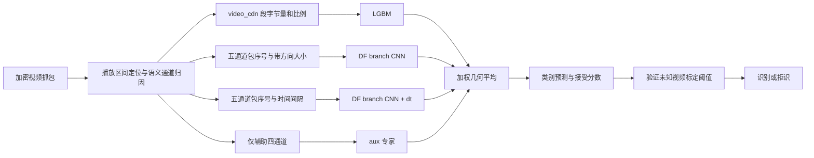

**技术路线概览与性能提升建议｜2026-11-01**

本报告基于当前代码、数据 manifest／预处理版本、已有实验 JSON 和本轮缓存诊断。代码基线为 `e5b2b70`。本轮没有重训模型、修改生产实现或替换现有权重；新组合打分试验只使用验证概率。已经验证的结论、代码问题和待验证的方案在下文分别说明。

**核心判断：当前项目最值得投入的是输入信息的可靠性、专家之间的互补性和跨未知视频的阈值迁移。** 严格协议下闭集 top1 已达 97.54%，但 TPR@0.5%FPR 为 65.39%；只有约 2.46 个百分点是闭集分类错误，另外约 32.15 个百分点是“分类正确、却未通过严格拒识阈值”。继续优化单模型 top1，并不必然改善主要指标。

**当前技术路线已经形成“多视角表示 → 专门模型 → 概率融合 → 未知视频拒识”的体系。**

输入来自 644 个 YouTube 视频的重复播放。预处理先通过 click-and-block 定位播放区间，再按 SNI、DNS、IP 前缀等线索归入 `video_cdn/api/channel_info/thumbnail/other` 五个语义通道。定位本身依赖采集侧标记，因此目前首先成立的是“播放区间已经被定位”的识别能力；连续混合流量下的端到端定位能力还需单独验证。

两条主要表示各有作用。LGBM 使用 45ms 间隔切出的传输片段，取前 16 段的字节量、相对比例、间隔、时长等，共 120 维。DF 将每通道的事件按包序号排列，编码为带符号的 log 大小，另有增加通道内 dt 的变体。每通道独立卷积，四轮池化后拼接分类；裁头、截尾、大小缩放和通道丢弃用于减少会话特有因素的影响。包序号表示能弱化纯时间重排的干扰，但不能保证对实际分包、GRO、重传、编码版本变化完全不变。

aux 专家单独读取四个非 video_cdn 通道。它的价值是提供不同的证据：两个全通道 DF 在验证未知视频上预测同一已知类的比例约 52%，aux 与它们仅约 7.4%／7.6%。这里是观察到的错误互补性，不能视为统计独立的证明。它单独的测试 top1 仅 62.60%，加入系统却有明显收益；文档部分位置的 65.4% 实际是该模型的验证 top1。

当前推荐组合为四成员 geo4，成员顺序是 LGBM、DF、DF+dt、aux，seed42 权重为 `0.35/0.10/0.20/0.35`。实现会将几何平均结果重新归一化，闭集取 argmax，开集用归一化后的最大概率。它属于专家概率集成，还不是具有学习型路由器的稀疏 MoE。

代码依据：[输入及划分](E:/evb/df/src/data.py)、[段特征](E:/evb/df/src/segment.py)、[DF 表示和网络](E:/evb/df/src/dfnet.py)、[训练入口](E:/evb/df/scripts/run_df.py)、[组合器](E:/evb/df/scripts/run_combiner.py)。

**必须用严格协议作为后续优化的共同基准。**

| 系统／口径 | 测试 top1 | TPR@0.5%FPR | @1% | @5% |
|---|---:|---:|---:|---:|
| 旧交叠协议 gcfisher_a | 97.4% | 86.1% | 88.4% | 93.3% |
| 严格协议 geo3，seed42 | 97.29% | 55.13% | 62.51% | 81.93% |
| 严格协议 geo4，seed42 | **97.54%** | **65.39%** | **72.94%** | **88.04%** |

第一行与后两行不可直接比较。旧协议中标定和测试未知池共享视频身份；严格协议是 386 个已知视频、129 个验证未知视频、129 个测试未知视频，未知身份完全分开。已知视频仍按会话划分训练／验证／测试，这是闭集识别任务的设计，并不要求已知身份跨池互斥。

geo4 对 geo3 的测试提升在双侧视频簇配对 bootstrap 下，0.5% 档 95% 区间为 **+5.02 至 +15.11 个百分点**。已有四个 DF 训练 seed 的 geo4 结果为 65.39%、66.92%、64.38%、68.11%，均值 66.20%；四个 seed、三档指标的配对提升区间都排除零。但这些实验固定了数据划分和 LGBM，证明的是训练随机性的稳健性，尚未证明换视频划分、换时间或换网络后的稳健性。

还需区分两种阈值口径。上表的 TPR@FPR 是在测试未知分布上读取 ROC 工作点，适合比较分数排序能力；实际部署应先在验证池定阈值，再原样应用。geo4 在验证侧按 0.5% 定阈后，测试实际 FPR 为 **1.115%**，对应 TPR 为 73.79%。后者不能写成“TPR@0.5%FPR=73.79%”。已有 GPD 实验也没有解决这个迁移问题。

证据：[aux 验收](E:/evb/df/runs/t2_aux_eval/report.json)、[四 seed 汇总](E:/evb/df/runs/ms_agg/report.json)、[部署阈值实验](E:/evb/df/runs/t3_gpd/report.json)。README 的主表仍主要展示旧协议，BEST_MODEL 的末尾也保留了“多 seed 未做”等旧描述；阅读时应以这些 JSON 和后续严格协议章节为准。

**本轮数据核查改变了几项原有优先级。**

| 核查项 | 本轮结果 | 对技术路线的影响 |
|---|---|---|
| 样本量 | 10s：19,399 会话；5s：19,392 会话；均为 644 视频 | 已知训练仅 6,937 会话，不宜直接假设大模型更合适 |
| 数据环境 | 单设备、Android、WiFi、同一 App 版本、auto 清晰度 | 目前最缺的是环境覆盖，而非同环境重复次数 |
| 日期 | 全库 13 个采集日期；每视频中位 7 个日期 | 已有数据可以先做跨日期诊断和重新划分 |
| 5s／10s 来源 | 19,362 对 session_id 的原始 pcap 哈希和 capture_id 都相同 | 可按原始 capture 统一划分，再研究早退和多预算训练 |
| 前缀关系抽查 | 随机抽查 64 对训练会话，事件及 path_id 均为精确前缀 | 支持预算联合路线；全量实现前仍应检查全部配对样本 |
| 视频长度截断 | 仅 0.814% 会话超过 4096；训练池为 0.678% | 8192 长度不应列为默认首选；可能收益主要集中在少量长尾 |
| 其他通道截断 | api 0.928%；channel_info 1.103%；thumbnail 0.021%；other 0% | 应按通道／错误子群分配长度预算，而不是统一翻倍 |
| 通道缺失 | other 缺失 41.60%；channel_info 3.77% | 有必要显式表示“缺失”与“有观测但不支持”的区别 |
| 质量标记 | warning 5,035 会话，占 25.96%，主要是原始时间戳非单调 | 不宜直接删除四分之一样本；当前整数毫秒缓存无时间倒退，验证 warning 子集也未更差 |
| 抓包去重 | 10s 内 19,399 个不同 pcap 哈希，无哈希重复跨 split | 未发现同一原始抓包在该数据集内部跨划分重复 |

“10s”实际是前两个下载 batch，“5s”主要是前一个 batch，并非固定墙钟截断。两者区间时长中位分别为 4.626s、2.070s，10s 的 p90 为 13.667s。当前早退实验报告的省时不能直接理解成“固定 10 秒变固定 5 秒”。在线部署还要计入起点定位、判断 batch 结束所需的静默等待，以及模型计算时间。

另外，约 36.28% 的事件绝对大小超过 1500B，最大值为 20,000B，其中恰好 20,000B 的事件占约 1%。这提示应核查上游事件粒度和可能的大小上限，不能直接把这些事件都理解为链路上的独立 MTU 包；仅凭数值集中不能断言已经发生裁剪。抽查 256 个训练会话，events 与 10ms bins 的总字节数全部一致，因此两种派生表示自洽，但这不足以证明相对原始 pcap 无信息损失。

本轮核查数据保存在 [data_audit.json](E:/evb/df/runs/route_review/data_audit.json)。

**输入和数据集方面，优先补足独立信息及真实变化。**

1. **先统一 capture 分组和预算划分。** 同一原始抓包派生的 5s、10s、其他时间前缀必须属于同一训练／验证／测试组；不要直接把现有独立划分训练出的两套模型拼接作新的早退证据。以同一严格划分重训短预算模型，检查所有源 capture 的训练交集。
2. **增加未知视频的种类和分布覆盖。** 0.5% 档的阈值受少数高分未知视频主导。优先增加不同内容、频道、编码、网络条件的未知身份，而不是对 129 个身份反复增加播放次数。设置互不交叠的 OE／开发／阈值标定／最终测试池；如不做 OE，则保留后三者。困难负样本从开发池挖掘，包含相近内容、同频道、相近片段大小的不同 VID，并保留普通随机未知视频作为代表性对照。
3. **先做现有数据的时间外推，再补环境数据。** 用较早日期训练、较晚日期评估已知会话；同时保持未知视频身份互斥。新增采集采用可控的小规模因子组合：设备、WiFi／蜂窝、限速／时延、App 版本、冷／热缓存、清晰度和编码。每个条件覆盖多 VID，避免“设备条件就是类别标签”。清晰度等采集标签可用于诊断和分组，不能在部署不可见时当作模型必需输入。
4. **保留语义归因质量。** 输入除了事件，还应保留有效长度、通道是否观测到、SNI／DNS／前缀归因来源等质量信息。先验证这些信息跨日期是否稳定，再用于缺失处理或门控，不把 IP 当视频身份捷径。
5. **增加表示，而非仅拉长表示。** 试验相邻同方向字节量、累计字节进度、多个时间尺度的上下行计数／字节量，以及按连接聚合的请求—响应片段。粗时间表示应有对齐、尺度和跨日期控制；早期细粒度 10ms 固定对齐表示失败，并不等于所有时间表示都无效。段阈值可以做小范围多尺度对照，但不得假定每个 gap 切块就是真实媒体段。

数据增强应模拟经过测量的变化：大小守恒的分包／合包、时延伸缩、短前缀截断、真实通道缺失。当前“所有下行事件同时乘近似比例”只能近似部分码率变化，不能代表编码切换或各媒体段的非均匀变化。外部研究也支持把网络条件覆盖作为独立实验轴：[NetCLR／NetAugment](https://arxiv.org/abs/2309.10147) 和 [网络仿真下的可解释指纹数据研究](https://petsymposium.org/popets/2023/popets-2023-0125.php)。这些主要研究 Tor 网站指纹，方法可以借鉴，收益数值不能迁移到本项目。

**建模方面，优先恢复有效对照，并让不同通道学习适合自己的尺度。**

一个具体问题需要先修复：`run_df.py` 创建了全局 `seg_std`，也算出了各池的 `seg_rows`，但训练和预测直接使用池内 `idx` 访问全局表。结果是 `--side seg` 时，包序列与段特征错配。对当前严格划分核对，train／val_probe／test_probe 的局部行号与正确全局行号没有一个相同。相关行在初始提交已存在；历史 `df_branch_all_seg` 确实启用了该选项。正确做法是先为每个池构造对应的段特征表，再使用局部下标，或始终返回并使用全局下标。**应修复后重新比较 branch 与 branch+segment，原负结果不能用于排除这条路线。** 这也不意味着修复必然超过独立 LGBM 专家：共同训练可能重新削弱错误互补性。

定位：[池映射](E:/evb/df/scripts/run_df.py:124)、[训练取值](E:/evb/df/scripts/run_df.py:168)、[推理取值](E:/evb/df/scripts/run_df.py:54)。当前 geo4 的 DF 成员均 `side=none`，不受此问题影响。

其余值得做的建模对照：

- **改进 aux 的局部结构。** 所有通道目前都经过四轮池化，api 中位 279 个事件，channel_info 仅 35 个事件。可为短通道尝试较浅网络、不同池化尺度和有效长度掩码，保留细小请求序列；将 api 与 thumbnail/channel_info 分开训练小专家，是比统一加宽更明确的互补假设。要用最终组合收益验收，不能只看 aux 的 top1。
- **增加一个真正不同的表示专家。** 例如粗字节量／方向 burst 的小 CNN 或 LGBM，配合多尺度或相邻合并增强，作为现有包序号专家的补充。RF 的 Traffic Aggregation Matrix 提供了“改变表示来获得稳健性”的参考，但需要针对本项目的字节量和辅助通道重新设计。[RF 原论文](https://www.usenix.org/conference/usenixsecurity23/presentation/shen-meng)
- **用跨会话监督约束替代单纯更换分类头。** 如同 VID 不同日期作为正对、不同 VID 的相似粗特征作为困难负对，训练粗粒度表示的一致性，保留 CE 防止分类能力退化。它改变的是训练样本关系和表示，不等同于此前只换 ArcFace 头的实验。现有数据每类样本少，应列为中等风险；预训练也需排除最终测试身份与抓包，除非明确另设传导式协议。
- **使 checkpoint 选择对应最终目标。** 当前只按 val top1 保存最佳模型，可能错过更能拒识未知的模型。可预先固定少量候选 checkpoint，在内层开发划分评价其加入固定专家系统后的增量，再在独立标定池定阈。不要直接在同一小型未知池上逐 epoch、逐组合反复调试。
- **将容量和长度扩展列为条件性实验。** 先证明错误集中在被截断会话，或训练与验证确实共同欠拟合，再增加视频长度、网络宽度和训练轮数。严格实验中的最佳 epoch 为 e100 96、dt 80、aux 72，也不能把“旧实验 100 轮仍上升”概括为所有成员都缺训练时长。

两项实现细节应随新实验一并处理。`DFNet` 虽接受 `widths`，但 flatten 维数写死了末层 256，修改末层宽度需要同步修正维数计算。通道 dropout 用 `j>0` 保护第一个通道；在 aux-only 模型中第一个是 api，因此它实际不会被整通道丢弃。若研究缺失鲁棒性，应显式按通道语义制定策略，并保留旧策略对照，不能静默改变现有基线。

**专家组合方面，保留 geo4 为基线，把新增成员的“独立纠错能力”作为准入条件。**

建议比较的对象是五种角色：包序号大小、时间间隔、辅助请求、粗字节量／burst、跨会话原型或验证器。新增成员前先问：在基线误接收的未知会话上，它是否降低了基线预测类别的支持？在原本可接受的真会话上，它是否又造成过多否决？再用视频簇配对检验评价整体增量。

训练随机种子只是一种多样性来源，输入视角和观测机制通常更值得优先尝试。本轮把四个已有 seed 按角色先平均，再按 seed42 权重组合，验证 @0.5% 为 79.06%（seed42 基线 77.34%），但 @1% 为 80.71%（基线 81.28%）。这还不是全面收益，而且需要九个 DF 前向而非三个。可以作为“不新增训练”的对照，不能直接升级为推荐系统。

对于学习型门控，优先考虑**观测质量驱动的少量规则／小模型**，例如通道缺失、有效包数、归因可信度、预算档位。不要默认让门控追随最高 softmax：当前最危险的未知视频恰恰是过度自信的样本。门控需使用按视频分组的折外预测训练，并分别检验常见／罕见质量状态；移除专家或改变权重后必须重新标定接受分数，不能继续沿用旧阈值。更复杂的类别条件门控只在数据支持时再做。

**本轮发现了一个可以低成本验证的打分补充，但证据尚不充分。**

现有 geo 是归一化后的乘积。设

\[
r_c(x)=\exp\left(\sum_i w_i\log p_{i,c}(x)\right),\quad
Z(x)=\sum_c r_c(x),\quad P_c(x)=r_c(x)/Z(x).
\]

当前开集分数只用 `max P`。当专家彼此不认同，`Z` 可以很小；归一化会消除这个整体一致程度的信息。可保留原类别答案，改用

\[
s_\beta(x)=\log\max_c P_c(x)+\beta\log Z(x).
\]

其中 β=0 是现有排序；β=1 等价于未归一化的最大乘积分数。它不需要逐类未知身份 ECDF，也不同于既有 q 族改变均值算子的方式。`Z` 是分布重叠的线索，不是经过证明的独立似然或已知概率。

本轮固定各 seed 既有权重，只在验证集试 `β∈{0,.1,.25,.5,1}`：

| DF seed | 基线 β=0：@0.5% | β=.1 | β=.25 |
|---|---:|---:|---:|
| 42 | 77.34% | 78.98% | 79.39% |
| 43 | 76.85% | 77.83% | 78.33% |
| 44 | 76.77% | 76.60% | 78.98% |
| 45 | 79.23% | 79.72% | 78.65% |

固定 β=.25 在 3/4 seed 改善，另一个退步，所以不能宣称稳定正收益。补做已知／未知视频各自五折、只在其余折选择 β 并标定阈值的局部检查，选出的 β 多为 .1／.25，召回上升，但部分 seed 的实际 FPR 也从约 .59%／.62% 升到 .74%／.77%。而且原专家权重早已使用完整验证集选择，因此这个检查并不是整个选择流程的完整嵌套评估。

结论是“值得进入独立验收的小型候选”，不是“已有新最优”。下一步预先固定 β 或选择规则，用新开发／标定划分和视频簇区间验收；若收益只来自更高实际 FPR，则拒绝升级。结果保存在 [单 seed 扫描](E:/evb/df/runs/route_review/score_probe.json) 与 [多 seed 和局部折外检查](E:/evb/df/runs/route_review/score_probe_multiseed.json)。本轮没有读取测试概率来选择这个新分数。

**后续实验建议按以下顺序推进。**

| 优先级 | 实验 | 要解决的具体问题 | 最小对照与验收 |
|---|---|---|---|
| P0 | 固化严格基准、capture ID／类别 ID／划分哈希、独立标定池 | 错配、缓存复用和反复选模导致结论不可靠 | 重现已有 geo4；oracle 与部署 FPR 分开报告 |
| P0 | 修复段特征索引，复测 branch+seg | 已有融合负结果被错配干扰 | 相同数据、seed、增强与训练预算；比较单模型及加入 geo4 后的增量 |
| P1 | 新增未知身份；跨日期／跨条件评估 | 低 FPR 尾部受未知群体变化主导 | 独立未知身份和采集日期；同时看实际 FPR、宏平均及最差子群 |
| P1 | 多尺度字节量／burst 专家 | 当前两个 DF 错误同质化 | 固定 geo4 加一个成员，衡量未知误接收下降和已知误拒增加 |
| P1 | aux 分通道结构与质量处理 | 短通道过度压缩、缺失状态被混淆 | api／其他辅助通道小专家、旧 aux、同参数量对照 |
| P1（效率） | 同 capture 的短前缀→长前缀早退 | 识别质量与观察时长的权衡 | 统一严格划分；实际决策时间、升级率、延迟 p50/p95、FPR 和 TPR |
| P2 | 保留 Z 的打分补充 | 几何归一化丢掉整体一致信息 | 预先限制 β 网格；独立标定和簇检验；不给实际 FPR 上升记作提升 |
| P2 | 跨会话一致性／验证式专家 | 类权重分类器缺少样本级支持检查 | 同 VID 跨日期正对、困难负对；与既有 gallery cosine 区分对照 |
| P3 | 8192 长度、统一加宽、复杂 MoE、更多同源 seed | 容量或计算预算的条件性收益 | 先确认瓶颈，再报告相同推理成本下的增量 |

所有新成员在低成本内层筛选通过后再做多训练 seed；结构选定后再做多划分 seed和时间外推。报告以视频簇为重采样单位，对新旧系统做配对比较；同一未知视频的约 30 次播放不是 30 个独立身份。外层测试用于确认预先确定的配置；现有测试已被多轮探索反复观察，后续强结论最好增加新的外部测试池。0.5% 为主指标，同时检查 1%、5%、闭集、误报视频数量和实际部署 FPR，避免只赢一个工作点。

**以下方向暂不应恢复为主线。** 当前实验设置中，类维 ECDF 在未知身份变化时失效；TTA、简单换 ArcFace 头、普通分歧特征 stacking、q 族、GPD 阈值和单成员 OE 没有形成可靠的 geo4 升级。这些是带边界的负结果，不是这些方法在所有新数据、新表示下都不可能有效。只有改变了对应的输入信息、训练目标或分布覆盖，才值得重新开启。

IP 候选剪枝和 LGBM top-K 候选掩码也不宜继续投入。候选掩码并不省掉当前 CNN 的前向；类别数会影响分类头成本，但在本实现里先跑完整模型再掩码没有算力收益。若将来规模扩展到数万 VID，检索和验证两阶段才值得重新设计。

推理效率上优先评估短预算早退、现有模型的批处理与输入流水线，再考虑量化／蒸馏。FP16、INT8 或蒸馏即使保持 top1，也可能改变未知分数尾部，必须重新标定并复测低 FPR，不能只以闭集准确率验收。当前没有统一延迟基准，本报告不声称已有推理加速。

**工程侧还有两项复现保障应前置。** 原始序列缓存按 manifest 行号隐式对齐，段特征缓存主要检查行数，概率文件一般只保存矩阵和 `probe_y`，缺少完整 session_id、class_id 顺序及源数据／协议指纹。在新增 split 或输入版本前，应让缓存显式存储并核验这些信息；否则“行数相同”并不能保证样本相同。本轮没有发现现有 geo4 概率已错配，指出的是后续扩展风险。另应将严格协议设为实验的显式参数，并在结果表标明成员、划分、训练 seed、标定池和阈值口径。

这一项目与 [Beauty and the Burst](https://www.usenix.org/conference/usenixsecurity17/technical-sessions/presentation/schuster) 所研究的内容相关 burst 侧信道在机制上相符。下一轮最有价值的进展，应是证明新的观测视角能减少共同误接收，或证明相同识别能力在更广的真实分布、更短的观测预算下仍成立。

